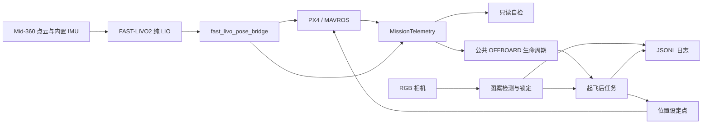

# 代码架构

项目保持一个 ROS 包 `simple_target_follow`，按职责拆 Python 模块。
所有原有 launch 名称、话题、服务、默认参数及控制门限保持不变。

## 运行链路

LIO 使用 `/livox/imu`，不使用相机或飞控 IMU。
视觉跟随使用 RGB；RealSense 深度未启用。PX4 自身仍负责位置控制和估计融合。

## 模块职责

下面路径均相对包目录。

| 文件 | 职责 |
| --- | --- |
| `scripts/offboard_hover_test.py` | 兼容的 ROS 入口：初始化节点，按 `tracking_enabled` 选择悬停或追踪；纯悬停时不加载视觉模块 |
| `src/simple_target_follow/offboard_mission.py` | 公共 OFFBOARD 生命周期：启动/终止服务、设定点预发送、切模式、解锁、起飞、悬停、降落、人工接管 |
| `src/simple_target_follow/marker_mission.py` | 追踪任务：图像回调、识别结果发布、跟随、丢失等待、返回起飞悬停点和日志调用 |
| `src/simple_target_follow/mission_telemetry.py` | 公共 PX4 状态订阅、接收时间、位姿稳定窗口、桥接进度及起飞前检查快照；不发送控制指令 |
| `scripts/hover_preflight_check.py` | 一次性只读自检，在公共遥测检查上增加点云、内置 IMU、原始 LIO 检查和报告 |
| `src/simple_target_follow/mission_safety.py` | 不依赖 ROS 的安全判断：新鲜度、电池、估计器、FCU、桥接和预检结果 |
| `src/simple_target_follow/hover_mission.py` | 不依赖 ROS 的任务阶段、限值、爬升高度、误差和扰动恢复判断 |
| `src/simple_target_follow/marker_detection.py` | 图像中的圆环和十字检测，不发送飞行指令 |
| `src/simple_target_follow/marker_follow.py` | 连续锁定、滤波和有速度/半径限制的 XY 设定点计算 |
| `src/simple_target_follow/marker_run_log.py` | 每轮独立 JSONL 文件、线程安全写入和非有限数值处理 |
| `src/simple_target_follow/pose_bridge.py` / `scripts/fast_livo_pose_bridge.py` | 位姿桥接计算与 ROS 节点，发布给 PX4 并提供桥接健康状态 |

`scripts/` 里的定位验收、硬件监测、色块节点仍保持独立入口。
其检查对象和操作目的不同，不合并成飞行任务。

## 两种任务如何共享起飞

两个 launch 都运行 `scripts/offboard_hover_test.py`，节点名称分别保持为
`offboard_hover_test` 和 `offboard_marker_follow`。

入口创建 `OffboardHoverTest` 或其子类 `OffboardMarkerFollow`。
公共 `run()` 完成就绪等待、显式启动门控、OFFBOARD/解锁和起飞，随后调用 `_run_task()`，最后降落。

- 悬停任务的 `_run_task()` 只执行配置的悬停。
- 追踪任务的 `_run_task()` 先调用公共悬停，再跟随和返回。

追踪不再通过覆盖 `_hover()` 把整段任务隐含地塞进悬停；起飞和降落仍只有一套实现。
修改起飞、接管或降落应在公共生命周期中进行；修改识别、跟随与目标丢失规则应在追踪模块中进行。
纯计算优先留在不依赖 ROS 的模块中。

`/target_follow/hover_test/start` 与 `/target_follow/marker_follow/start` 是 Trigger 服务。
launch 只加载节点，服务请求经就绪和许可检查后才进入飞行流程。

## 配置与历史资料

`config/offboard_hover_test.yaml` 保存公共飞行默认值；`config/marker_follow.yaml`
覆盖追踪所需参数（包括 3 秒悬停），追踪 launch 最后设置服务名和许可参数。

`launch/includes/color_camera.launch` 保存追踪和色块预览共用的 RGB 相机配置。
`start_camera:=false` 继续支持已有相机节点或离线回放。
`sensor_bringup.launch` 是独立的旧深度＋Xsens 方案，不混入当前 RGB 配置。

`reference/` 和 `docs/legacy_*` 保留溯源，旧控制器不会被安装或启动。
本次整理不更改 `calibration_runs/`、历史日志、驱动工作空间或 PX4 参数。
